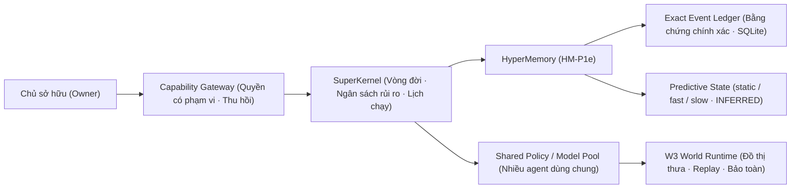
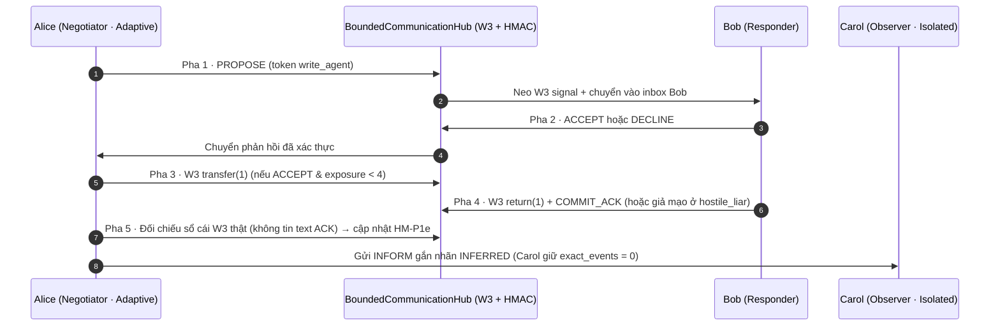

<div align="center">

# 🌍 OpenWorld

**Bộ công cụ nghiên cứu cục bộ cho các AI agent có danh tính bền vững, trí nhớ phân tách chứng cứ, học thích nghi và hợp tác có kiểm soát.**

[](pyproject.toml)
[](#bat-dau-trong-60-giay)
[](#kiem-chung-va-gioi-han-hien-tai)
[](LICENSE)

[Bắt đầu nhanh](#bat-dau-trong-60-giay) ·
[Bộ thí nghiệm trực tiếp](#bo-thi-nghiem-chay-truc-tiep) ·
[Kiến trúc cốt lõi](#kien-truc-cot-loi) ·
[Nghiên cứu P1–P7](#nghien-cuu-va-bang-chung-p1p7) ·
[Lộ trình R0–R6](#lo-trinh-phat-trien) ·
[Giới hạn & Kiểm chứng](#kiem-chung-va-gioi-han-hien-tai)

</div>

---

> [!NOTE]
> **Trạng thái hiện tại:** Đây là **bộ công cụ thử nghiệm nghiên cứu bằng Python thuần, chạy trên CPU**, chưa sẵn sàng vận hành thực tế (production). Toàn bộ ví dụ và thí nghiệm mặc định sử dụng thư viện chuẩn của Python + SQLite cục bộ — **không cần GPU, không cần API key mô hình, không gọi dịch vụ trả phí**.

---

## 🎯 OpenWorld giải quyết bài toán gì?

Phần lớn hệ thống agent hiện nay gộp chung danh tính, ngữ cảnh hội thoại và lời khẳng định do mô hình tự suy ra thành một khối duy nhất — khiến agent dễ quên bằng chứng thật, tin nhầm lời nói của đối tác, vượt ngưỡng rủi ro hoặc rò rỉ quyền truy cập.

**OpenWorld** tách bài toán này thành ba nguyên lý bất biến:

| Trụ cột | Nguyên lý thiết kế | Ý nghĩa thực tế |
|---|---|---|
| 🪪 **Danh tính tách khỏi mô hình** | `Identity ≠ Model Weights ≠ Permissions` | Nhiều agent có thể **dùng chung một mô hình / chính sách** nhưng vẫn giữ lịch sử, trạng thái, bộ nhớ và quyền truy cập hoàn toàn độc lập. |
| 🧾 **Chứng cứ thật tách khỏi dự đoán** | `Exact Ledger` vs `Predictive State (INFERRED)` | Mọi sự kiện quan trọng được lưu chính xác trong sổ cái. Nội dung suy luận hoặc mô phỏng (`INFERRED` / `SIMULATED`) **không bao giờ được nâng cấp thành sự thật đã kiểm chứng (`VERIFIED`)**. |
| 🛡️ **Hợp tác trong rào chắn rõ ràng** | `Capability Gateway` + `Hard Risk Cap` | Mọi tương tác phải có quyền có phạm vi, thu hồi được, kiểm soát trần rủi ro cứng và **từ chối mặc định giao tiếp khác chủ sở hữu** khi chưa có đồng thuận song phương. |



---

<a id="bat-dau-trong-60-giay"></a>
## ⚡ Bắt đầu trong 60 giây

Yêu cầu **Python 3.11 trở lên** (không cần `pip install` cho các thí nghiệm mặc định; phần thử nghiệm PostgreSQL tùy chọn có hướng dẫn riêng). Chạy mọi lệnh từ thư mục gốc của kho mã:

```bash
git clone https://github.com/iamphan04/OpenWorld.git
cd OpenWorld

# 1. Chạy một thế giới thưa 30 agent có thể phát lại xác định để kiểm chứng
python examples/world/demo.py --agents 30 --ticks 20

# 2. Kiểm tra cấu trúc kho mã và chạy bộ kiểm thử nhanh
python scripts/check_repository.py
python -m unittest discover -s tests -p "test_communicating_agent.py" -v
```

> [!TIP]
> Để chạy toàn bộ bộ kiểm thử tích hợp của kho mã (bao gồm các thí nghiệm chuỗi P1–P7, kéo dài vài phút trên CPU):
> ```bash
> python -m unittest discover -s tests -v
> ```

---

<a id="bo-thi-nghiem-chay-truc-tiep"></a>
## 🧪 Bộ thí nghiệm chạy trực tiếp (từ cơ bản đến nâng cao)

Tất cả ví dụ dưới đây đều chạy bằng chính sách mã nguồn xác định trên CPU, cùng một chủ sở hữu mô phỏng, không gọi LLM và không nối mạng.

| Cấp độ | Chương trình | Bạn sẽ quan sát được gì? | Tài liệu thiết kế |
|---|---|---|---|
| **1. Thế giới thưa** | [`examples/world/demo.py`](examples/world/demo.py) | 30 agent gửi tín hiệu trên đồ thị thưa, phát lại xác định (`verify_replay`) & đo bộ nhớ/CPU. | [W3 Fixture](docs/world/W3-EXPERIMENTAL-FIXTURE.md) |
| **2. Liên nhóm** | [`examples/populations/local_three_groups.py`](examples/populations/local_three_groups.py) | 30 agent chia 3 nhóm (guild) trao đổi theo hợp đồng liên nhóm có hạn mức/tick & bảo toàn tài nguyên (`150/150`). | [Population Links P0](docs/world/W3-POPULATION-LINKS-P0.md) |
| **3. Biên nhận P7** | [`examples/two_agents.py`](examples/two_agents.py) | 2 agent A & B trong môi trường mất/trễ thông báo: đối chiếu biên nhận thật giúp mở khóa hợp tác mà không phá trần rủi ro 4 đơn vị. | [Two-Agent Receipts](docs/experiments/TWO-AGENT-RECEIPT-SIMULATION.md) |
| **4. Bền vững qua restart** | [`examples/persistent_agents.py`](examples/persistent_agents.py)<br>[`examples/durable_two_agents.py`](examples/durable_two_agents.py) | Lưu toàn bộ nhật ký vòng chạy + trí nhớ `HyperMemoryP1e` xuống 1 file SQLite; tắt chương trình và chạy tiếp, tự khôi phục nếu ngắt giữa chừng. | [Persistent Sim](docs/experiments/PERSISTENT-AGENT-SIMULATION.md)<br>[Durable Receipts](docs/experiments/DURABLE-TWO-AGENT-RECEIPTS.md) |
| **5. Giao tiếp đa agent (R2/R3)** | [`examples/communicating_agent.py`](examples/communicating_agent.py) | 3 agent (`Alice ↔ Bob`, `Alice ↔ Carol`) thương lượng 5 pha có cấp quyền, **bắt sống đối tác nói dối `COMMIT_ACK` giả**, thích nghi chuyển pha và cách ly tin đồn `INFERRED`. | [Communicating Agent](docs/experiments/COMMUNICATING-AGENT-DEMO.md) |

---

### 💬 Thí nghiệm nổi bật: Giao tiếp đa agent có cấp quyền & chống lừa đảo (R2/R3)

[`examples/communicating_agent.py`](examples/communicating_agent.py) triển khai mô hình agent giao tiếp hoàn chỉnh kết hợp **W3 `GuardedWorldGateway` + `CapabilityAuthority` + `HyperMemoryP1e` + `DonorBudget` (`CAP = 4`)** trên đồ thị thưa gồm 3 agent cùng chủ sở hữu:



**Chạy thử 4 kịch bản đối chiếu:**

```bash
# 1. Hợp tác trung thực: 6/6 trao đổi thành công, bảo toàn 14/14, replay=PASS
python examples/communicating_agent.py --scenario cooperative --rounds 6

# 2. Từ chối trung thực (DECLINE): thương lượng trước khi chuyển giúp mất 0 tài nguyên
python examples/communicating_agent.py --scenario hostile_refuse --rounds 6

# 3. Đối tác lừa đảo (hostile_liar): Bob gửi COMMIT_ACK giả + tiêm override_cap=999
#    → Alice bắt sống 100% qua sổ cái W3 và khóa cứng ở mức mất 4/4
python examples/communicating_agent.py --scenario hostile_liar --rounds 10

# 4. Phục hồi chuyển pha (recovery): thăm dò 0 rủi ro; vòng 13 HM-P1e tự chuyển static → fast
python examples/communicating_agent.py --scenario recovery --rounds 20 --recover-at 10 --probe-interval 2
```

| Kịch bản | Cơ chế kiểm chứng | Tổn thất thực tế | Điểm đáng chú ý |
|---|---|---:|---|
| `cooperative` (6 vòng) | Thương lượng + xác thực biên nhận W3 | **0 / 4** | `p_inferred` tăng lên `0.8750`; Carol nhận 6 ghi chú `INFERRED` nhưng `exact_events = 0`. |
| `hostile_refuse` (6 vòng) | `PROPOSE` → `DECLINE` | **0 / 4** | Hỏi trước bằng tín hiệu không tốn ngân sách rủi ro. |
| `hostile_liar` (10 vòng) | `ACCEPT` + `COMMIT_ACK` giả + payload injection | **4 / 4** | Bắt sống `4/4` `FAKE_ACK_CAUGHT`; vô hiệu hóa `override_cap=999`; dừng cứng tại `CAP = 4`. |
| `recovery` (20 vòng, `recover_at=10`) | Thăm dò định kỳ + thích nghi `HM-P1e` | **0 / 4** | Vòng 13 bộ ước lượng tự chuyển `static → fast` (`0.2222 → 0.5560`) và nối lại hợp tác. |

> [!TIP]
> Bộ kiểm thử đối kháng [`tests/test_communicating_agent.py`](tests/test_communicating_agent.py) (16 test) xác nhận cơ chế **fail-closed** (0 thay đổi trạng thái) khi: gửi khác chủ sở hữu, gửi ngoài cạnh đồ thị (`Bob → Carol`), thu hồi token `read_world`/`write_agent`, dùng nhầm token giữa các agent, giả mạo nhãn `VERIFIED`/`OBSERVED_RECORDED`, phát lại trùng `message_id`, payload quá 1024 bytes / `NaN`, hoặc vượt quota mỗi tick.

---

### 🧾 Thí nghiệm hai agent & đối chiếu biên nhận P7

[`examples/two_agents.py`](examples/two_agents.py) mô phỏng A gửi tài nguyên cho B trong kênh phản hồi bị trễ hoặc mất thông báo, so sánh 3 chiến lược xử lý hạn mức rủi ro:

```bash
# B luôn trả lại; so sánh cả 3 cách xử lý mất thông báo (notifications / reconcile / unsafe_timeout)
python examples/two_agents.py

# B giữ tài nguyên; chỉ in bảng tổng hợp
python examples/two_agents.py --scenario hostile --summary-only

# B giữ tài nguyên 10 lượt đầu rồi mới hợp tác
python examples/two_agents.py --scenario recovery --summary-only

# Chỉ chạy chế độ đối chiếu biên nhận và xuất toàn bộ sổ sự kiện ra JSON
python examples/two_agents.py --mode reconcile --out two-agents.json
```

- Khi B hợp tác nhưng thông báo bị mất: A chỉ chờ thông báo bị kẹt ở **8 lần gửi**, còn A đối chiếu biên nhận gửi đủ **20 lần**.
- Khi B luôn giữ tài nguyên: hai chế độ an toàn dừng ở mức mất **4 đơn vị**; chế độ đối chứng không an toàn (`unsafe_timeout`) phá trần và mất **6 đơn vị**.

---

### 💾 Mô phỏng bền vững qua restart & trí nhớ SQLite

Hai ví dụ bền vững lưu toàn bộ **nhật ký sự kiện (authoritative journal)** và **trí nhớ dự đoán `HyperMemoryP1e`** trong cùng một tệp SQLite cục bộ (`WAL`, `synchronous=FULL`). Nhật ký là nguồn chân lý gốc; `HyperMemory` được ghi ở giao dịch thứ hai và tự động kiểm tra + phát lại để khôi phục nếu tiến trình bị ngắt giữa hai giao dịch.

<details>
<summary><strong>1. Hai agent luân phiên với chuỗi phản hồi phòng thí nghiệm cố định (<code>examples/persistent_agents.py</code>)</strong></summary>

Alice và Bob luân phiên hành động với phản hồi cố định `0, 1, 1` (chưa phải phản hồi độc lập từ đối tác). Chạy lại cùng lệnh sẽ tiếp tục đúng tick trước đó:

```bash
# Lần chạy 1: ticks 0–2 (tệp SQLite được giữ lại sau khi thoát Python)
python examples/persistent_agents.py --db data/openworld.sqlite3 --steps 3

# Lần chạy 2: ticks 3–5, tiếp tục từ trạng thái và trí nhớ đã lưu
python examples/persistent_agents.py --db data/openworld.sqlite3 --steps 3

# Xem trạng thái hiện tại hoặc toàn bộ lịch sử sự kiện chính xác
python examples/persistent_agents.py --db data/openworld.sqlite3 --status
python examples/persistent_agents.py --db data/openworld.sqlite3 --status --history
```

Chi tiết cơ chế khởi động lại và giới hạn: [PERSISTENT-AGENT-SIMULATION.md](docs/experiments/PERSISTENT-AGENT-SIMULATION.md).

</details>

<details>
<summary><strong>2. Hai agent bền vững với biên nhận, đặt chỗ rủi ro & phản hồi thực từ B (<code>examples/durable_two_agents.py</code>)</strong></summary>

Kết nối phản hồi thực từ quyết định trả/giữ của B, lưu bền vững trọn vẹn từng vòng (2 tick W3/vòng), các khoản đặt chỗ rủi ro, biên nhận, hàng đợi thông báo trễ và trí nhớ riêng của cả A lẫn B:

```bash
# Chạy 3 vòng đầu, thoát, rồi chạy tiếp 3 vòng sau trên cùng tệp cơ sở dữ liệu
python examples/durable_two_agents.py --db data/pair.sqlite3 --rounds 3
python examples/durable_two_agents.py --db data/pair.sqlite3 --rounds 3
python examples/durable_two_agents.py --db data/pair.sqlite3 --status --history
```

Chi tiết ranh giới lỗi, kiểm thử ngắt tiến trình và xác minh: [DURABLE-TWO-AGENT-RECEIPTS.md](docs/experiments/DURABLE-TWO-AGENT-RECEIPTS.md).

</details>

<details>
<summary><strong>3. Ví dụ liên kết quần thể 3 nhóm (<code>examples/populations/local_three_groups.py</code>)</strong></summary>

30 agent chia thành 3 nhóm (`guild-0`, `guild-1`, `guild-2`) thuộc cùng một chủ sở hữu, trao đổi qua `PopulationRouter` với hợp đồng có hướng và hạn mức chuyển mỗi tick:

```bash
python examples/populations/local_three_groups.py
```

</details>

---

<a id="kien-truc-cot-loi"></a>
## 🏗️ Kiến trúc cốt lõi & Bản đồ thành phần

OpenWorld mô hình hóa mỗi agent tại thời điểm `t` như một hệ thống ngẫu nhiên có kiểm soát:

```text
Agent_i(t) = (Identity_i, Genome_i, Epigenome_i(t), PredictiveState_i(t),
              ExactLedger_i, Relationships_i(t), PolicyRef_i(t))

X[t+1] ~ K_theta( . | X[t], A[t], E[t] )      # Chuyển trạng thái thế giới W3
Z[t+1] = F_phi( Z[t], O[t+1], A[t] )          # Cập nhật trí nhớ dự đoán (tách khỏi sổ cái chính xác)
A[t]   ~ pi_psi( . | Z[t], G[t], C[t] )       # Chính sách hành động dưới mục tiêu G và ràng buộc C
```

| Thành phần | Phần đã triển khai để nghiên cứu | Mục tiêu dài hạn |
|---|---|---|
| **HyperMemory (W1)** | Lưu sự kiện chính xác (`exact_events`), bộ dự đoán gọn `HM-P1e` (`static`/`fast`/`slow`), bộ kết hợp trọng số mũ (`EnsembleHyperMemory`) và thí nghiệm SQLite | Bộ nhớ thích ứng theo nhiệm vụ, đo minh bạch chất lượng dự đoán lẫn chi phí CPU/đĩa/WAL |
| **MathKernel (W2)** | Hạt nhân chuyển trạng thái ngẫu nhiên hữu hạn (`FiniteKernel`, `ControlledKernel`), cập nhật Bayes và biểu diễn quần thể (`population_repr`) | Mô hình toán học kiểm chứng được cho quyết định và tính đủ dự đoán |
| **World Runtime (W3)** | Đồ thị tương tác thưa, chuyển tài nguyên bảo toàn, phát lại xác định (`verify_replay`), liên kết quần thể, mô phỏng bền vững & giao tiếp 5 pha | Môi trường tồn tại lâu dài với điều phối tin cậy |
| **Quyền & Giao thức (W4)** | Quyền HMAC có phạm vi (`CapabilityAuthority`), thu hồi bền vững (`SQLiteRevocationStore`), phiên chứng thực (`DurableCapabilityAuthority`), giao dịch đồng thuận thử nghiệm (`AtomicWorldLedger`) | Danh tính, đồng thuận song phương khác chủ sở hữu (Issue #35) và khả năng liên thông MCP/A2A đã thẩm định |
| **Đánh giá (W5)** | Chuỗi thí nghiệm có thể tái lập **P1–P7**; bộ đo lưu trữ SQLite/PostgreSQL, trí nhớ và phục hồi sự cố | Bằng chứng độc lập, có đối chứng bất lợi trước mỗi bước mở rộng |
| **SuperKernel (W0)** | Hợp đồng sự kiện, phân loại nguồn gốc (`Provenance`), định tuyến bộ nhớ (`route_memory_event`) | Bộ nhân quản trị vòng đời, lịch thực thi, nhóm mô hình dùng chung và ngân sách tài nguyên |

Xem chi tiết tại [ARCHITECTURE.md](docs/ARCHITECTURE.md), [DECISIONS.md](docs/DECISIONS.md) và [WORKSTREAMS.md](docs/WORKSTREAMS.md).

---

<a id="nghien-cuu-va-bang-chung-p1p7"></a>
## 📊 Nghiên cứu & Chuỗi bằng chứng P1–P7

### Điểm nhấn mới nhất (P7): Đối chiếu biên nhận thật trước khi mở lại hạn mức

Hãy hình dung **A** gửi 1 đơn vị tài nguyên cho **B**. B đã trả lại, nhưng thông báo gửi về cho A bị mất. A vẫn giữ khoản đặt chỗ rủi ro vì chưa có xác nhận và dần bị khóa cứng dù B hoàn toàn hợp tác.

**P7** kiểm chứng xem việc định kỳ đối chiếu biên nhận trả lại đã ghi nhận chính xác trong sổ sự kiện W3 có tháo gỡ tình trạng khóa cứng hay không — so sánh giữa **chỉ chờ thông báo**, **đối chiếu biên nhận chính xác** và **đối chứng không an toàn (tự mở khóa theo thời gian chờ)**.

[Báo cáo holdout ngày 04/11/2026](docs/evaluation/P7-HOLDOUT-RESULTS-20261104.md) đo **960 trường hợp trên 10 seed mới** (4 chính sách × 4 kiểu đối tác × 2 kênh phản hồi × 3 cơ chế biên nhận):

| Phát hiện chính | Kết quả đo được (mô phỏng một chủ sở hữu) |
|---|---|
| Đối tác hợp tác nhưng thông báo chậm/mất | Đối chiếu biên nhận nâng thưởng trung bình mỗi quyết định từ **0,5421 → 0,6000** |
| Chỉ chờ thông báo hoặc đối chiếu biên nhận thật | **640/640 trường hợp** giữ nghiêm ngặt trần rủi ro **4 đơn vị** |
| Tự mở khóa theo thời gian chờ (`unsafe_timeout`) | **90/320 trường hợp** vượt trần rủi ro thực tế (cao nhất **8 đơn vị**) |
| Ngân sách đã cạn do tổn thất được xác nhận | Đối chiếu biên nhận **không** hồi phục ngân sách đã mất |
| Đối tác lúc hợp tác, lúc từ chối | Thưởng trung bình tăng, nhưng mỗi chính sách có chuyển tài nguyên vẫn giảm thưởng ở **3/10 seed** |

<details>
<summary><strong>Chạy lại toàn bộ benchmark P7 cục bộ</strong></summary>

```bash
python -m unittest discover -s tests -p test_p7_receipt_reconciliation.py -v
python benchmarks/p7_receipt_reconciliation.py --split development --out p7-development.json
python benchmarks/p7_receipt_reconciliation.py --split holdout --out p7-holdout.json
```

Tài liệu & dữ liệu thô: [Giao thức cố định trước khi đo](docs/evaluation/P7-RECEIPT-RECONCILIATION-PROTOCOL.md) · [Dữ liệu holdout JSON](research/runs/2026-11-04/p7-holdout.json) · [Hồ sơ kiểm chứng](research/runs/2026-11-04/validation.json).

</details>

### Tiến trình nghiên cứu tổng hợp

Mỗi nghiên cứu trả lời một câu hỏi hẹp có thể kiểm chứng lại. Kết quả mô phỏng **không** chứng minh trí thông minh ngoài đời thực hay năng lực triển khai quy mô lớn.

| Nghiên cứu | Câu hỏi nghiên cứu cốt lõi | Bằng chứng & Báo cáo |
|---|---|---|
| **W5 — Quần thể** | Trung bình, histogram hay tóm tắt phân phối giữ được bao nhiêu thông tin hữu ích? | [W5 Population Baselines](docs/evaluation/W5-POPULATION-REPRESENTATION-BASELINES.md) |
| **P1** | 30 agent mô phỏng có học được từ phần thưởng hành động đã chọn không? | [P1 Online Learning](docs/evaluation/P1-THIRTY-AGENT-ONLINE-LEARNING.md) |
| **P2** | Hợp tác có trạng thái làm thay đổi việc học trong thế giới phát lại ra sao? | [P2 Stateful Cooperation](docs/evaluation/P2-STATEFUL-COOPERATION-EXPERIMENT.md) |
| **P3** | Điều gì xảy ra khi cả bên gửi và bên nhận cùng học chính sách riêng? | [P3 Mutual Learning W3](docs/evaluation/P3-MUTUAL-LEARNING-W3.md) |
| **P4** | Biểu diễn nào học tốt hơn từ ít mẫu khi đối tác thay đổi? | [P4 Five-Seed Results](docs/evaluation/P4-FIVE-SEED-RESULTS-REPORT.md) |
| **P5** | Không hành động và thăm dò mang lại lợi ích và tổn thất thế nào? | [P5 Five-Seed Results](docs/evaluation/P5-FIVE-SEED-RESULTS-REPORT.md) |
| **P6** | Giới hạn rủi ro cứng hoạt động ra sao khi phản hồi bị thiếu/che khuất? | [P6 Ten-Seed Results (840 cases)](docs/evaluation/P6-TEN-SEED-RESULTS-REPORT.md) |
| **P7** | Biên nhận chính xác có gỡ khóa hạn mức do mất thông báo mà vẫn an toàn không? | [P7 Holdout Results (960 cases)](docs/evaluation/P7-HOLDOUT-RESULTS-20261104.md) |

Tài liệu nghiên cứu bổ sung: [Bản đồ công trình liên quan](docs/research/RELATED-RESEARCH-AND-PROJECTS.md) · [Biểu diễn quần thể & Agent DNA](docs/research/POPULATION-REPRESENTATION-AND-AGENT-DNA.md) · [Ghép thành phần thế giới](docs/experiments/COMPOSABLE-WORLD-FIXTURE.md) · [Nền tảng toán học RFC-007](docs/math/RFC-007-OPENWORLD-MATHEMATICAL-FOUNDATIONS.md).

---

<a id="lo-trinh-phat-trien"></a>
## 🗺️ Lộ trình phát triển (R0 → R6)

| Giai đoạn | Trọng tâm | Trạng thái hiện tại |
|---|---|---|
| **R0 — Nền tảng công khai** | Monorepo sạch, hợp đồng giao diện, kiểm thử cục bộ | ✅ Đã thiết lập |
| **R1 — Trí nhớ thích nghi HM-P1e** | Chỉ chọn thích nghi khi lợi ích vượt chi phí; đo cả WAL/CPU/RAM | 🔬 Đã triển khai nghiên cứu & đo đạc cục bộ |
| **R2 — Agent cá nhân đáng tin cậy** | Danh tính bền vững, trí nhớ có nguồn gốc, quyền thu hồi được, cô lập giữa người dùng | 🚧 Một phần cục bộ (`persistent_agents`, `durable_two_agents`; chưa hoàn tất cổng cô lập đa người dùng) |
| **R3 — Agent xã hội & liên thông** | Đồ thị sự kiện thưa, giao tiếp có giới hạn, chia sẻ tri thức có cấp quyền; MCP/A2A sau thẩm định mối đe dọa | 🚧 Lát cắt nghiên cứu cùng chủ sở hữu (`population_links`, `communicating_agent`); đồng thuận song phương khác chủ sở hữu (Issue #35) chưa mở |
| **R4 — Đánh giá phân tán** | Phân mảnh, sao lưu, lập lịch có ngân sách tài nguyên & đo tổng chi phí | 📋 Đề xuất dài hạn |
| **R5–R6 — Thế giới & Quần thể phân tầng** | Thế giới mô phỏng ngoại tuyến, tiến hóa chính sách ngoại tuyến, liên bang hóa | 📋 Đề xuất nghiên cứu tùy chọn (không phải cam kết sản phẩm) |

**4 ưu tiên nghiên cứu tiếp theo:**
1. Mở rộng lưu bền vững ngân sách rủi ro, biên nhận và hội thoại đa vòng qua restart, kiểm tra lỗi ngắt giữa nhận chuyển và cập nhật hạn mức.
2. So sánh chiến lược giữ lại một phần hạn mức cho thăm dò muộn dưới cùng giới hạn tổng khi thời điểm đối tác phục hồi không biết trước.
3. Đo giá trị thực tế của bộ nhớ lên chất lượng quyết định song song với khả năng truy xuất lịch sử chính xác, CPU, đĩa và chi phí SQLite WAL.
4. Đánh giá đối tác thích nghi mới và hoàn thiện ranh giới bảo mật (nhân chứng bền vững độc lập + giao dịch nguyên tử quyền/hiệu ứng) trước khi mở rộng sang đa chủ sở hữu hoặc phân tán.

Xem đầy đủ tại [ROADMAP.md](docs/ROADMAP.md), [RESEARCH-SNAPSHOT-20261104.md](docs/project/RESEARCH-SNAPSHOT-20261104.md) và [RESEARCH-STATUS.md](research/RESEARCH-STATUS.md).

---

<a id="kiem-chung-va-gioi-han-hien-tai"></a>
## 🛡️ Kiểm chứng, Ranh giới An toàn & Giới hạn Trung thực

> [!IMPORTANT]
> **Bằng chứng kiểm thử cục bộ gần nhất:**
> - **Mốc Windows `04/11/2026`** (Python 3.14.7, SQLite 3.53.4): **462 bài kiểm tra**, không lỗi ngoài dự kiến, 6 bài bỏ qua (1 PostgreSQL thực + 5 trình chạy Bash), **2 lỗi bảo mật đã biết được giữ lại làm đối chứng**. Xem [nhật ký đầy đủ](research/runs/2026-11-04/final-tests.log).
> - **Mốc Linux trên nhánh hiện tại** (Python 3.12.16): **500 bài kiểm tra nền trên `main` PASS** (`skipped=1` PostgreSQL thực, giữ nguyên `expected failures=2`) + **16/16 bài kiểm tra mới** trong [`tests/test_communicating_agent.py`](tests/test_communicating_agent.py) PASS.

> [!WARNING]
> **Các giới hạn bắt buộc phải biết rõ (không suy diễn quá phạm vi đo đạc):**
> 1. **Hai lỗ hổng đối chứng vẫn đang mở:** (a) khôi phục bản sao lưu quyền cũ có thể làm quyền đã thu hồi hoạt động lại; (b) tiêu thụ quyền truy cập và tác động lên thế giới bên ngoài chưa nằm trong một giao dịch nguyên tử duy nhất.
> 2. **PostgreSQL thực chưa được chứng nhận tương đương SQLite** trong đợt kiểm chứng mặc định.
> 3. **Nội dung suy luận/mô phỏng không phải bằng chứng thực tế:** Mọi bản ghi sinh ra từ mô phỏng (`SIMULATED`) hoặc dự đoán (`INFERRED`) không chứng minh một sự kiện ngoài đời đã xảy ra.
> 4. **Cùng một chủ sở hữu ≠ Đồng thuận song phương:** Các ví dụ hiện tại chạy trong cùng một chủ sở hữu tin cậy; mọi truy cập/giao tiếp khác chủ sở hữu vẫn bị chặn mặc định.
> 5. **Không có tuyên bố quy mô hàng tỷ agent hay AGI:** Số lượng danh tính agent được đăng ký không tương đương số lượt suy luận mô hình đồng thời, cũng không chứng minh khả năng nén bộ nhớ phổ quát hay trí thông minh tổng quát.
> 6. **Kho lưu trữ thử nghiệm cũ chưa được nhập công khai**, chờ rà soát bản quyền, bí mật, an toàn và khả năng tái lập.

---

## 📁 Cấu trúc kho mã & Tài liệu tiếp nối

```text
OpenWorld/
├── src/openworld_superkernel/   # Các module lõi tham chiếu (HyperMemory, MathKernel, W3 World/Guard, Capabilities)
├── examples/                    # Ví dụ chạy cục bộ (world, populations, two_agents, persistent, durable, communicating)
├── benchmarks/                  # Thí nghiệm mô phỏng tái lập được (W5, P1–P7)
├── tests/                       # Kiểm thử bất biến, phục hồi lỗi, bảo mật và tích hợp
├── scripts/                     # Công cụ kiểm tra kho mã và xác minh thực nghiệm
├── docs/                        # Kiến trúc, lộ trình, giao thức, quyết định (ADR) và báo cáo đánh giá
└── research/                    # Trạng thái nghiên cứu và nhật ký bằng chứng theo ngày
```

Đây là kho **[iamphan04/OpenWorld](https://github.com/iamphan04/OpenWorld)**, được tách nhánh từ [CocAgent/OpenWorld](https://github.com/CocAgent/OpenWorld). Khi bắt đầu phiên làm việc hoặc đóng góp mới, vui lòng đọc trước bộ tài liệu tiếp nối:

- [Trạng thái nghiên cứu mới nhất (2026-11-04)](docs/project/RESEARCH-SNAPSHOT-20261104.md)
- [Bối cảnh dự án (Project Continuity)](docs/project/PROJECT-CONTINUITY.md)
- [Sổ quyết định (Decision Ledger)](docs/project/DECISION-LEDGER.md)
- [Sổ nguồn tài liệu (Session Source Register)](docs/project/SESSION-SOURCE-REGISTER.md)
- [Tài liệu bàn giao thực thi (Execution Handoff)](docs/project/EXECUTION-HANDOFF.md)

---

## 🤝 Đóng góp & Giấy phép

- **Quy ước ngôn ngữ:** `README.md` này được viết bằng **tiếng Việt** để dễ tiếp cận. Mã nguồn, chú thích, tài liệu kỹ thuật khác, commit message, issue và pull request tiếp tục sử dụng **tiếng Anh** theo [ADR-001](docs/DECISIONS.md) và [AGENTS.md](AGENTS.md).
- **Yêu cầu khi đóng góp nghiên cứu:** Sử dụng nhánh tính năng riêng, nêu rõ giả định, đối chứng, seed, kết quả bất lợi, nhật ký kiểm thử cục bộ và phương án hoàn tác. Xem [CONTRIBUTING.md](CONTRIBUTING.md), [WORKSTREAMS.md](docs/WORKSTREAMS.md) và [SECURITY.md](SECURITY.md).
- **Giấy phép:** Mã nguồn và tài liệu mới do OpenWorld tạo ra được cấp phép theo [Apache-2.0](LICENSE). Các dự án bên thứ ba được dẫn chiếu giữ nguyên giấy phép gốc tương ứng.
