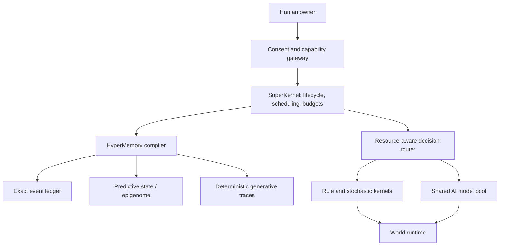

# Architecture — Draft RFC-005

## System boundaries



## Non-negotiable invariants

1. Agent identity is independent from its model weights, memory and permissions.
2. Inferred or simulated content is never presented as verified history.
3. Protected and externally consequential events are retained as exact records according to retention rules.
4. Memory mutation and evidence references are atomic at an explicitly defined consistency boundary.
5. Deterministic replay requires the algorithm version, seed, checkpoint and every external input; actual outside-world observations are not reconstructed.
6. Cross-owner memory use requires authorization and auditability.
7. Performance reports include runtime overhead such as WAL, indexing and replication.
8. Synthetic results do not establish scalability to millions or billions of active agents.

## Mathematical kernel

```math
X_{t+1} \sim K_\theta(\cdot\mid X_t,A_t,E_t),\quad
Z_{t+1}=F_\phi(Z_t,O_{t+1},A_t),\quad
A_t\sim\pi_\psi(\cdot\mid Z_t,G_t,C_t).
```

`X` is the system state, `Z` predictive memory, `K` a controlled transition kernel and `\pi` a constrained action policy. Exact historical evidence is maintained **outside** predictive memory.

## Architecture choices

Start with dependency-free Python contract tests and a local SQLite research baseline. Build protocols and distributed infrastructure only when an independently measured workload justifies the complexity. All public interfaces are versioned.

## Mathematical foundations

The formal W2 MathKernel research specification is [RFC-007](math/RFC-007-OPENWORLD-MATHEMATICAL-FOUNDATIONS.md). Its implementation gates are documented in [MathKernel P0](math/MATHKERNEL-P0-IMPLEMENTATION-GATES.md). These are **proposed mathematical contracts**, not production proofs or completed implementation.
